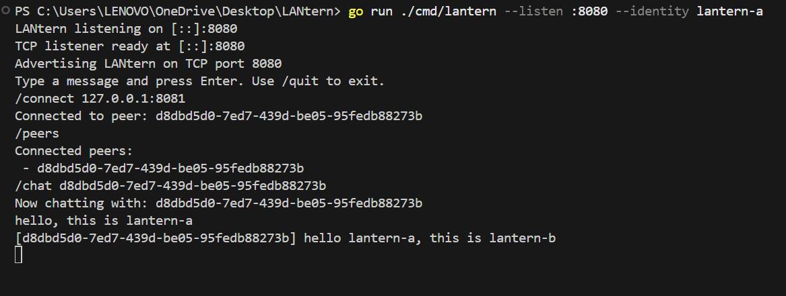
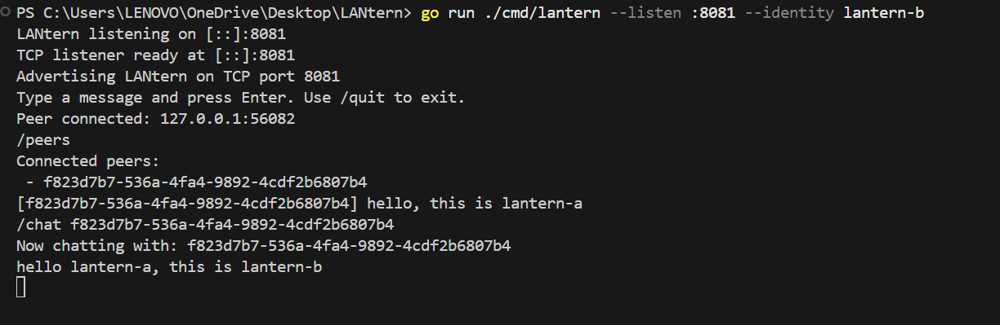

# LANtern

> **LANtern — Light up your local network.**

[](https://go.dev/)

LANtern is an offline-first, peer-to-peer chat application that lets users on the same local network discover each other, connect, and exchange messages — with zero reliance on a central server or internet connection.

Everything runs over raw TCP sockets using a custom length-prefixed framing protocol and a structured JSON message format. Peers identify themselves with persistent UUIDs, connect directly over TCP (with mDNS service discovery implemented), and perform a `HELLO` handshake before exchanging messages. It's networking fundamentals brought to life in Go.

---

## Table of Contents

- [In Action](#in-action)
- [Features](#features)
- [Technology Stack](#technology-stack)
- [Installation & Running](#installation--running)
  - [Prerequisites](#prerequisites)
  - [Option 1 — Download Pre-built Binary](#option-1--download-the-pre-built-binary)
  - [Option 2 — Clone & Build from Source](#option-2--clone--build-from-source)
  - [Makefile Commands](#makefile-commands)
  - [Quick Start — Two Peers on One Machine](#quick-start--two-peers-on-one-machine)
  - [Connect the Peers](#connect-the-peers)
  - [Chat](#chat)
  - [CLI Flags](#cli-flags)
  - [Connecting Across Devices on the Same LAN](#connecting-across-devices-on-the-same-lan)
  - [Windows Firewall](#windows-firewall)
  - [Troubleshooting](#troubleshooting)
- [Architecture & Project Structure](#architecture--project-structure)
  - [How a Message Flows](#how-a-message-flows)
  - [Service Discovery: mDNS and mDNS-SD](#service-discovery-mdns-and-mdns-sd)
- [What I Learned Building LANtern](#what-i-learned-building-lantern)
- [Testing](#testing)
  - [What's Tested](#whats-tested)
- [Current Limitations](#current-limitations)
  - [Probable Future Enhancements](#probable-future-enhancements)
- [Contributing](#contributing)

---

## In Action

Two terminals on the same machine, chatting over TCP:

<table>
<tr>
<td width="50%">

**Peer A** — listening on `:8080`, connects to Peer B, sends a message



</td>
<td width="50%">

**Peer B** — listening on `:8081`, receives a connection, replies



</td>
</tr>
</table>

Peer A starts first, then uses `/connect 127.0.0.1:8081` to reach Peer B. Both peers list connected peers with `/peers`, select a chat target with `/chat <peer-id>`, and start typing messages. Incoming messages are displayed automatically regardless of whether you have selected a chat target — `/chat` is only required for *sending*.

---

## Features

- **TCP peer-to-peer connections** — direct socket communication, no intermediate server.
- **Custom length-prefixed framing** — a 4-byte big-endian header encodes the payload length before every message, solving TCP's byte-stream boundary problem.
- **JSON message envelopes** — every frame carries a JSON-encoded `Envelope` containing the message type, a unique message ID, sender ID, UTC timestamp, and payload.
- **`HELLO` handshake** — both sides exchange a `HELLO` envelope on connection to identify themselves. The handshake validates the remote peer's identity and rejects self-connections.
- **Message acknowledgements** — the receiver automatically sends an `ACK` envelope referencing the original message ID after every `MESSAGE`.
- **Sender ID validation** — post-handshake messages are verified against the peer's declared identity, rejecting spoofed sender IDs.
- **Persistent peer identity** — each LANtern instance loads its UUID from disk (or generates and persists a new one on first run), so your identity survives restarts.
- **Concurrent connection handling** — each accepted connection runs in its own goroutine with `sync.WaitGroup` tracking, allowing multiple simultaneous peers.
- **Race-safe peer management** — a `sync.RWMutex`-protected `Manager` tracks all connected peers and prevents duplicate connections.
- **mDNS service discovery (implemented, unverified)** — LANtern uses mDNS-SD (Multicast DNS Service Discovery) to advertise itself as a `_lantern._tcp` service and can scan for peers via `/discover`. However, discovery has not yet been verified successfully — local Windows tests currently return no service entries, and cross-device behavior remains unverified.
- **Runtime peer connection** — use `/connect <host:port>` to connect directly to any peer on your network without restarting.
- **Graceful shutdown** — `context.Context` + `os/signal` propagates cancellation to the listener and all connection handlers; `sync.WaitGroup` ensures all goroutines finish before exit.
- **Interactive CLI** — built-in commands for peer listing, peer selection, discovery, connection, and exit.

> **Note on Discovery Status:** mDNS advertising and lookup are implemented, but discovery has not yet been verified successfully. Local Windows tests currently return no service entries; cross-device behavior remains unverified.
>
> The primary reason is that testing was conducted on a hostel/campus Wi-Fi network. Such networks enforce **client isolation** (AP isolation) and block inbound traffic between devices, which suppresses UDP multicast packets and blocks direct peer-to-peer TCP connections.
>
> **mDNS and mDNS-SD explained:**
> - **mDNS (Multicast DNS, RFC 6762)**: Resolves hostnames to IP addresses without a central DNS server by multicasting DNS queries across the local subnet to `224.0.0.251` on UDP port `5353`.
> - **mDNS-SD (DNS-Based Service Discovery, RFC 6763)**: Builds on top of mDNS to discover named service instances rather than just machine names. LANtern publishes a `_lantern._tcp` service with `PTR` records for discovery, `SRV` records for the TCP port, and `TXT` records carrying peer metadata (`id=<peer-uuid>`, `version=1`).
> - On networks that block inbound traffic or filter multicast (like hostel Wi-Fi), `/discover` will return no results. Direct manual connection via `/connect <ip>:<port>` on an unrestricted network (or phone hotspot) is recommended.

---

## Technology Stack

| Layer | Technology |
|---|---|
| **Language** | Go 1.26 |
| **Networking** | `net` (TCP sockets) |
| **Protocol** | Custom 4-byte length-prefixed framing + JSON envelopes |
| **Concurrency** | Goroutines, `sync.WaitGroup`, `sync.RWMutex`, `sync.Mutex`, channels |
| **Context & Signals** | `context.Context`, `os/signal.NotifyContext` |
| **Identity** | `github.com/google/uuid` — persistent UUIDs |
| **Discovery** | `github.com/hashicorp/mdns` — mDNS-SD (Multicast DNS Service Discovery) advertisement and lookup (unverified) |
| **Serialization** | `encoding/json`, `encoding/binary` (big-endian) |
| **I/O** | `io.ReadFull` for reliable reads, custom `writeFull` for reliable writes |
| **Testing** | `testing` — unit tests for framing, integration tests over live TCP |

---

## Installation & Running

### Prerequisites

- [Go 1.26+](https://go.dev/dl/) installed and on your `PATH` (only if building from source).
- Two terminal windows (to simulate two peers).

### Option 1 — Download the pre-built binary

A pre-built Windows `.exe` is available on the [Releases](https://github.com/abhishek8841/lantern/releases) page. Download `lantern.exe`, place it in a directory, and run it directly from PowerShell — no Go installation or cloning required.

### Option 2 — Clone & build from source

```powershell
git clone https://github.com/abhishek8841/lantern.git
cd lantern
go build -o bin/lantern ./cmd/lantern
```

Or use the Makefile:

```powershell
make build
```

### Makefile commands

| Command | Description |
|---|---|
| `make build` | Compile the binary to `bin/lantern` |
| `make run` | Build and run with defaults (`:8080`, `lantern-identity`) |
| `make run LISTEN=:9000 IDENTITY=my-peer` | Run with custom flags |
| `make run CONNECT=127.0.0.1:8081` | Run and auto-connect to a peer on startup |
| `make run-a` | Quick-start Peer A on `:8080` with identity `lantern-a` |
| `make run-b` | Quick-start Peer B on `:8081` with identity `lantern-b` |
| `make test` | Run all tests (`go test ./...`) |
| `make vet` | Run `go vet ./...` |
| `make clean` | Remove build artifacts |

### Quick start — two peers on one machine

The fastest way is with the Makefile shortcuts — open two terminals:

```powershell
# Terminal 1
make run-a
```

```powershell
# Terminal 2
make run-b
```

Or run directly with `go run`:

**Terminal 1 — Peer A** (listens on port 8080):

```powershell
go run ./cmd/lantern --listen :8080 --identity lantern-a
```

**Terminal 2 — Peer B** (listens on port 8081):

```powershell
go run ./cmd/lantern --listen :8081 --identity lantern-b
```

Both peers start a TCP listener and an mDNS advertisement automatically.

### Connect the peers

From **either** terminal, connect to the other peer:

```
/connect 127.0.0.1:8081
```

(Use the port of the peer you want to reach.)

### Chat

Incoming messages from any connected peer are displayed automatically — you do not need to run any command to receive them. The `/chat` command is only needed to select which peer you want to *send* to.

```
/peers                          # list connected peers
/chat <peer-uuid>               # select a peer to send messages to
hello from this side!           # type a message and press Enter
/exit-peer-chat                 # deselect the current chat target
/discover                       # scan for LANtern peers on the LAN via mDNS
/connect 192.168.1.42:8080      # connect to a peer on another device
/quit                           # shut down gracefully
```

### CLI flags

| Flag | Default | Description |
|---|---|---|
| `--listen` | `:8080` | TCP address to listen on (e.g. `:9000`, `0.0.0.0:8080`) |
| `--identity` | `lantern-identity` | Path to the identity file storing this peer's UUID |
| `--connect` | *(empty)* | Address of a peer to connect to immediately on startup |

### Connecting across devices on the same LAN

1. Find your local IP address (`ipconfig` on Windows, `ip addr` on Linux).
2. Start LANtern on machine A: `go run ./cmd/lantern --listen :8080 --identity peer-a`
3. On machine B: `go run ./cmd/lantern --listen :8081 --identity peer-b --connect 192.168.1.X:8080`

> `127.0.0.1` means "this computer." To reach another device, use its LAN IP address (e.g. `192.168.1.X`).

### Windows Firewall

When LANtern binds a TCP port for the first time, Windows may prompt you to allow the connection. Choose **"Allow access"** for private networks.

If you aren't prompted, you can create an inbound rule manually:

```powershell
# Run PowerShell as Administrator
New-NetFirewallRule -DisplayName "LANtern TCP" -Direction Inbound -Protocol TCP -LocalPort 8080 -Action Allow -Profile Private
```

For mDNS discovery to work, UDP port **5353** must be open for multicast traffic. However, discovery has not yet been verified successfully (local Windows tests return no service entries). Furthermore, many hostel, campus, and public Wi-Fi networks enforce **client isolation**, which drops multicast traffic and blocks inbound TCP connections between connected devices. On such networks, neither mDNS discovery nor cross-device TCP connections will work unless using a mobile hotspot or home router that permits peer-to-peer communication.

### Troubleshooting

| Problem | Likely cause | Fix |
|---|---|---|
| `dial peer: connection refused` | The remote peer isn't running or is on a different port | Verify the peer is listening and use the correct `host:port` |
| `bind: address already in use` | Another process is using the port | Choose a different port with `--listen :9000` |
| `No LANtern services found` from `/discover` | Discovery is unverified; hostel Wi-Fi blocks multicast & inbound traffic (client isolation), or firewall blocks UDP 5353 | Use direct `/connect <ip>:<port>` instead. For cross-device tests, switch to a mobile hotspot without client isolation. |
| Can't send messages | No peer selected for chat | Run `/peers` then `/chat <peer-id>` to select a send target |
| `remote peer has the same ID as local peer` | Both peers share the same identity file | Use different `--identity` paths |

---

## Architecture & Project Structure

```
lantern/
├── cmd/
│   └── lantern/
│       └── main.go              # CLI entry point, flag parsing, REPL command loop
├── internal/
│   ├── discovery/
│   │   └── mdns.go              # mDNS service advertisement and peer discovery
│   ├── identity/
│   │   └── identity.go          # Load or generate a persistent UUID peer identity
│   ├── peer/
│   │   ├── peer.go              # Peer struct and Connection interface
│   │   └── manager.go           # Thread-safe peer registry (add/remove/list/send)
│   ├── protocol/
│   │   ├── frame.go             # Length-prefixed framing: WriteFrame / ReadFrame
│   │   ├── frame_test.go        # Unit tests for framing (round-trip, multi-frame, edge cases)
│   │   ├── message.go           # Envelope type, JSON encode/decode, message types
│   │   └── id.go                # UUID-based message ID generation
│   └── transport/
│       └── tcp/
│           ├── listener.go      # TCP listener, connection acceptance, handshake, message loop
│           ├── client.go        # PeerConn: send/receive envelopes, handshake, dial
│           └── client_test.go   # Integration test: framed message over a live TCP connection
├── go.mod
├── go.sum
├── Makefile
└── .gitignore
```

### How a message flows

```
┌─────────────┐         TCP         ┌─────────────┐
│   Peer A    │◄───────────────────►│   Peer B    │
└──────┬──────┘                     └──────┬──────┘
       │                                   │
  1. StartListener()                  1. StartListener()
  2. /connect host:port ──────────►  2. Accept() incoming conn
  3. Handshake: HELLO ──────────────► 3. Handshake: HELLO
     ◄─────────────── HELLO ◄────────
  4. Manager.Add(peer)                4. Manager.Add(peer)
  5. User types message              5. readEnvelope loop
  6. Envelope{MESSAGE} ──► WriteFrame ──► ReadFrame ──► 
     ◄── ReadFrame ◄── WriteFrame ◄── Envelope{ACK}
  7. /quit → ctx cancel               7. EOF → cleanup
     Manager.CloseAll()                  Manager.Remove()
     WaitGroup.Wait()
```

1. **Startup** — the peer loads (or creates) its identity, starts a TCP listener, and initializes the mDNS service advertisement.
2. **Connection** — a peer dials another peer's address with `/connect` (or queries peers via `/discover` where supported). A raw TCP connection is established.
3. **Handshake** — both sides simultaneously send and read a `HELLO` envelope. Each side validates the remote identity (non-empty, not a self-connection).
4. **Registration** — the successfully handshaked peer is added to the `Manager`. Duplicate connections are rejected.
5. **Sending** — the user selects a peer with `/chat`, types a message, which is JSON-encoded into an `Envelope`, framed with a 4-byte length header, and written to the TCP connection.
6. **Receiving** — each connection has its own read loop that continuously calls `ReadFrame`, decodes the JSON `Envelope`, validates the sender ID, prints the message, and sends back an `ACK`. Incoming messages are displayed automatically without any user command.
7. **Shutdown** — `Ctrl+C` or `/quit` cancels the context, closes the listener, closes all peer connections via `Manager.CloseAll()`, and waits for all handler goroutines via `sync.WaitGroup`.

### Service Discovery: mDNS and mDNS-SD

In peer-to-peer applications, discovery answers: *how do peers find each other on a local network without hardcoded IP addresses?*

LANtern implements zero-configuration service discovery using two related protocols:

1. **mDNS (Multicast DNS — RFC 6762)**:
   Standard unicast DNS sends queries to a designated nameserver (such as your gateway router or `8.8.8.8`). mDNS replaces this on local networks by multicasting standard DNS format queries over UDP port **5353** to `224.0.0.251` (IPv4). Any host on the local subnet listening on the multicast group answers for its own local records without needing a central DNS server.

2. **mDNS-SD (DNS-Based Service Discovery — RFC 6763)**:
   While mDNS resolves hostnames to IPs, DNS-SD uses standard DNS record formats to discover *services*:
   - **Service Type**: LANtern registers the `_lantern._tcp` service type.
   - **PTR Records**: When `/discover` issues a query for `_lantern._tcp.local.`, all active LANtern instances respond with their service instance name.
   - **SRV Records**: Maps the service instance name to the target host and listening TCP port (e.g. `:8080`).
   - **TXT Records**: Publishes key-value metadata. LANtern broadcasts `id=<peer-uuid>` and `version=1`.

#### Why Discovery is Currently Unverified

> “mDNS advertising and lookup are implemented, but discovery has not yet been verified successfully. Local Windows tests currently return no service entries; cross-device behavior remains unverified.”

The primary reason is the test environment: LANtern was developed and tested on a hostel/campus Wi-Fi network. Shared institutional networks enforce **Client Isolation** (AP isolation) and block inbound traffic between devices:
- **Multicast traffic is suppressed**: Access points drop multicast packets (UDP 5353) to minimize wireless congestion, preventing `/discover` queries from reaching other machines.
- **Inbound traffic is blocked**: Routers block direct device-to-device communication, meaning a machine cannot accept inbound TCP connections from another machine on the same subnet.

Direct manual connection via `/connect <ip>:<port>` over an unrestricted network (such as a mobile hotspot or private home router) remains the reliable way to connect peers across devices.

---

## What I Learned Building LANtern

### TCP is a byte stream, not a message stream

TCP guarantees ordered, reliable delivery of bytes — but it makes no promises about message boundaries. One `Write("Hello")` call might arrive as `"Hel"` + `"lo"` on the other end. You *must* implement your own framing to know where one message ends and the next begins. LANtern uses a 4-byte big-endian length header before every payload: the receiver reads exactly 4 bytes, decodes the length, then reads exactly that many bytes. This simple protocol eliminates partial reads and message concatenation.

### Reliable I/O requires intent

`io.Read` can return fewer bytes than requested without error. For protocol headers and payloads of known length, `io.ReadFull` is essential — it blocks until exactly *n* bytes arrive or an error occurs. On the write side, LANtern uses a custom `writeFull` loop that handles short writes by advancing through the buffer. Network code can't assume one call does the whole job.

### Protocol design decisions compound

Wrapping every message in a JSON `Envelope` with `type`, `id`, `sender_id`, `timestamp`, and `payload` fields was a small upfront cost that paid off repeatedly. It made the handshake trivial (`type: HELLO`), enabled acknowledgements (`type: ACK` + `acknowledges_id`), made sender validation a one-line check, and left room for future message types without changing the framing layer. Separating framing (binary length headers) from serialization (JSON) keeps each layer testable in isolation.

### Concurrent networking demands discipline

Every accepted TCP connection spawns a goroutine. Those goroutines share a peer registry and can write to any connection. Without care, this is a race condition factory. LANtern uses `sync.RWMutex` in the `Manager` for concurrent-safe reads and exclusive writes, `sync.Mutex` on the `PeerConn` writer to prevent interleaved frames from concurrent sends, `sync.WaitGroup` to track active connection handlers, and channels for startup signaling (`ListenerResult`, `ConnectionResult`). Each primitive solves a specific coordination problem.

### Graceful shutdown is harder than it looks

Pressing `Ctrl+C` should close the listener, finish in-flight messages, close every connection, and exit without leaked goroutines. LANtern achieves this with `signal.NotifyContext` creating a cancelable context, a dedicated goroutine that closes the listener when the context is canceled, `Manager.CloseAll()` that sets a `shutting` flag and closes every connection, and `WaitGroup.Wait()` ensuring all handlers complete before the function returns. Getting this right required understanding how `Accept()` only unblocks when the listener is closed.

### Identity and handshake prevent confusion

Without a handshake, you'd accept any TCP connection and hope it speaks your protocol. LANtern's `HELLO` exchange solves this: both sides send their UUID, both sides validate the received UUID, and self-connections are explicitly rejected. Persisting the UUID to disk means a peer keeps the same identity across restarts — other peers can recognize it.

### Testing network code is possible and worthwhile

LANtern's frame tests use `bytes.Buffer` as a fake `io.Reader`/`io.Writer`, making them fast and deterministic. The TCP integration test spins up a real `net.Listen` on `127.0.0.1:0` (OS-assigned port), dials it, sends a framed message, and asserts the other side received it correctly — all within a single test function, with timeouts to prevent hangs. This caught real bugs that unit tests alone would have missed.

### Real-world networks break local discovery (mDNS, DNS-SD & client isolation)

Implementing mDNS and mDNS-SD with Go was an eye-opening lesson in network reality. On paper, zero-configuration networking looks seamless: nodes join a network, broadcast DNS-SD queries over UDP multicast (`224.0.0.251:5353`), and discover active services. In real life, however, shared environments like hostel and campus Wi-Fi enforce **client isolation**. They drop multicast packets to conserve bandwidth and block inbound connections between devices to isolate tenants. Building peer-to-peer software taught me that an open LAN is the exception, not the rule — direct IP/port fallback (`/connect`) and transparent feedback about network limitations are essential.

---

## Testing

Run all tests:

```powershell
go test ./...
```

Run with race detection:

```powershell
go test -race ./...
```

Run the Go linter:

```powershell
go vet ./...
```

### What's tested

- **`protocol/frame_test.go`** — round-trip write+read, multiple sequential frames, empty frames, incomplete payload detection (`io.ErrUnexpectedEOF`).
- **`transport/tcp/client_test.go`** — end-to-end framed message delivery over a live TCP connection with timeouts.

---

## Current Limitations

- **No encryption** — messages travel as plaintext over TCP. Do not use LANtern for sensitive communication.
- **No authentication** — peer IDs are self-declared and not cryptographically verified.
- **No message persistence** — messages exist only in the terminal; nothing is stored or replayed.
- **mDNS discovery unverified** — mDNS advertising and lookup are implemented, but discovery has not yet been verified successfully. Local Windows tests currently return no service entries; cross-device behavior remains unverified. In hostel and campus Wi-Fi environments, client isolation blocks inbound peer-to-peer traffic and drops UDP multicast (port 5353).
- **Single-peer send target** — you can send to only one peer at a time (though multiple peers can be connected and you receive messages from all of them simultaneously).

### Probable Future Enhancements

- [ ] Verify and debug mDNS-SD discovery across different network setups (e.g., mobile hotspot, home router) and OS platforms
- [ ] Auto-connect to discovered peers
- [ ] Message delivery status and retry logic
- [ ] Encrypted communication (TLS or Noise Protocol)
- [ ] Cryptographic peer identity and authentication
- [ ] Group messaging and broadcast
- [ ] Message history and persistence
- [ ] A polished TUI (terminal UI) with proper chat windows
- [ ] Cross-platform binary releases

---

## Contributing

LANtern is a learning project, but contributions are welcome:

- **Bug reports** — open an issue describing what happened and how to reproduce it.
- **Ideas** — suggest features or improvements via issues.
- **Pull requests** — fork the repo, create a branch, and submit a PR.

---

Built by [Abhishek](https://github.com/abhishek8841).
